<div align="center">

<!-- Animated Neural-Terminal Hero Banner -->


<br/>

<!-- Quick Interactive Status & Navigation Badges -->
<p>
  <a href="#-featured-projects"></a>
  <a href="#-featured-publication"></a>
  <a href="#-tech--pm-toolkit"></a>
  <a href="https://github.com/veronikamoron?tab=repositories"></a>
</p>

</div>

---

```yaml
# veronika@neuro-ai:~/profile.yml
name:      "Veronika"
roles:     ["Technical & AI Product Manager", "Technical Program Manager"]
education: "M.Sc. Neuroscience (1.1)"
location:  "Berlin → Freiburg, Germany"
mission:   "Bridging complex AI systems, clinical/user needs, and measurable business value."
focus:
  - "Product Strategy & End-to-End Program Delivery"
  - "Agentic AI, GraphRAG & Hybrid Retrieval Pipelines"
  - "Healthcare Tech & Data-Driven Systems"
```

<div align="center">
  
</div>

## ⚡ What I Build & Lead

<table>
  <tr>
    <td width="33%" valign="top">
      <h3>🎯 Product Management</h3>
      <p>Translating ambiguous technical possibilities into clear product vision: Requirements Engineering, PRDs, User Story Mapping, RICE prioritization, OKRs, and iterative user-centric discovery.</p>
    </td>
    <td width="33%" valign="top">
      <h3>🧭 Program Management</h3>
      <p>Orchestrating complex, cross-functional technical initiatives from kickoff to production: Roadmapping, Stakeholder Alignment, Milestone &amp; Dependency Tracking, Risk Mitigation, and Governance.</p>
    </td>
    <td width="33%" valign="top">
      <h3>🤖 Agentic AI &amp; RAG Systems</h3>
      <p>Hands-on prototyping of multi-step LLM pipelines, GraphRAG, Hybrid RAG (Dense + BM25 + Re-Ranking), Tool Calling, ReAct workflows, and automated evaluation pipelines in Python &amp; n8n.</p>
    </td>
  </tr>
</table>

<details>
<summary><code>$ cat operating_principles.md</code> &nbsp;<em>(click to expand)</em></summary>
<br/>

```text
01 // SCIENCE-FIRST RIGOR     → Hypotheses, measurable KPIs, and hallucination-free evaluation over hype.
02 // DUAL-TRACK EXECUTION    → Aligning product discovery (what & why) with program delivery (how & when).
03 // BUILD TO UNDERSTAND     → Prototyping in Python, FastAPI & Vector DBs to speak fluently with engineering teams.
04 // HIGH-STAKES READY       → Designing auditable, citation-grounded AI workflows suited for Healthcare & Enterprise IT.
```

</details>

<div align="center">
  
</div>

## 🚀 Featured Projects

| Project | Architecture & Impact | Links |
| :--- | :--- | :--- |
| **🧠 NeuroGraph**<br><sub>*3D Brain Connectivity GraphRAG*</sub> | GraphRAG engine for complex multi-hop neuroscience queries (`NetworkX` + `ChromaDB` + `Gemini`) featuring an interactive **3D WebGL connectome visualization** (`Three.js`) and built-in demo simulator. | [](https://veronikamoron.github.io/neurograph/)<br>[](https://github.com/veronikamoron/neurograph) |
| **🔬 ArXivLens**<br><sub>*Academic Research Studio*</sub> | Production-grade **Hybrid RAG** (`Dense` + `BM25` + `FlashRank` re-ranking) for arXiv literature built on a 100% free-tier Gemini stack with strict, hallucination-free inline citations. | [](https://arxivlens-studio.streamlit.app/)<br>[](https://github.com/veronikamoron/arxivlens) |
| **⚡ VC Pulse**<br><sub>*AI Pitch Deck Analyzer*</sub> | AI-powered pitch deck evaluation studio featuring multi-perspective **VC persona sparring**, structured investment scoring rubrics, and one-click Notion export. | [](https://pitch-deck-analyzer.streamlit.app/)<br>[](https://github.com/veronikamoron/ai-founders-master-konzept) |

<br/>

## 📄 Featured Publication

> **HIGHLIGHT · PEER-REVIEWED RESEARCH (`Current Biology` · Sep 29, 2026)**
>
> ### *Constitutively active presynaptic release factor Unc13A prevents homeostatic sleep rebound in Drosophila*
>
> Shows that a constitutively active form of the Munc13-family presynaptic release factor **Unc13A** suppresses homeostatic sleep rebound after acute sleep deprivation in *Drosophila* (near-complete elimination of recovery sleep, while baseline sleep remains largely normal). A genetic modifier screen identified partial loss of **αSnap** as a potent suppressor of the reboundless phenotype of `Unc13A^WRWR`, indicating that sleep rebound depends on a balance between **SNARE complex assembly and recycling**, with active Unc13A suppressing rebound sleep by increasing presynaptic release probability and enhancing synaptic transmission.
>
> [](https://doi.org/10.1016/j.cub.2026.09.007) [](https://doi.org/10.1016/j.cub.2026.09.007)

<details>
<summary><code>$ cat publication_abstract.txt</code> &nbsp;<em>(verbatim abstract — click to expand)</em></summary>
<br/>

> Here, we show that a constitutively active form of the Munc13-family presynaptic release factor Unc13A suppresses homeostatic sleep rebound following acute sleep deprivation in *Drosophila*, leading to a near-complete elimination of recovery sleep, while baseline sleep remains largely normal. Through a genetic modifier screen, we identified partial loss of αSnap as a potent suppressor of the reboundless phenotype of Unc13A<sup>WRWR</sup>. These findings suggest that sleep rebound depends on a balance between SNARE complex assembly and recycling and that active Unc13A suppresses rebound sleep by increasing presynaptic release probability and subsequently enhancing synaptic transmission.

</details>

<div align="center">
  
</div>

## 🛠️ Tech & PM Toolkit

**`// PRODUCT & PROGRAM MANAGEMENT`**

<p>
  
  
  
  
  
  
  
  
</p>

**`// AI, RAG & ENGINEERING`**

<p>
  
  
  
  
  
  
  
  
  
</p>

**`// DATA & SCIENTIFIC COMPUTING`**

<p>
  
  
  
</p>

---

<div align="center">
  <sub><code>EOF // Built with precision · Pitch-black neuro-tech aesthetic</code></sub>
</div>
